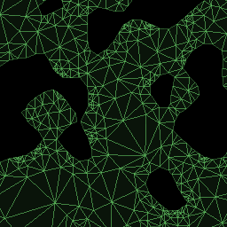

# Description
Simple repository containing all my prototypes for the game I'm making in C++ using Raylib.
Current prototype is purely for testing out edge collision and navmesh creation.

# Disclaimer
The project is still in it's early prototyping phase, many bugs are to be expected.
It is not a finished product nor to be used in other projects as of yet.
It is also compiled with raylib/w64devkit/g++ compiler, so will only build with a very specific architecture.
The application builds as a proper windows executable, so It will most likely get windows defender to flag it as a threat.

# Usage
In-app controls :
- App :
    - Escape or window close button to close the app.
- Movement :
    - WSAD to move player (gold circle object).
- World control : 
    - Up/Down to change perlin noise seed.
    - Left/Right to change perlin noise scale.
    - Scrollwheel to change perlin noise persistence.
    - [ / ] to change threshold for edge-detection (and background drawing).
- Visualisation help :
    - G to toggle grid.
    - E to toggle detected edges and boundries.
    - P to toggle detected edge end points.
    - N to toggle created navmesh.
    - C to toggle cursor location.
    - B to toggle background. (on by default)
    - I to toggle perlin noise information. (on by default) 

# Notices
This project uses the following open-source libraries :
- [Raylib](https://github.com/raysan5/raylib)
    - Licence : zlib Licence, found [here](docs/LICENCES/zlib%20Raylib%20LICENCE.txt).
    - Copyright : (c) 2013-2026 Ramon Santamaria (@raysan5)
    - Details : Used as the window manager and renderer for the project. 
- [siv::PerlinNoise](https://github.com/Reputeless/PerlinNoise)
    - Licence : MIT Licence, found [here](docs/LICENCES/MIT%20PerlinNoise%20LICENCE.txt).
    - Copyright : (C) 2013-2021 Ryo Suzuki <reputeless@gmail.com>
    - Details : Used for generating procedural world maps.
- [CDT (Constrained Delaunay Triangulation)](https://github.com/artem-ogre/CDT)
    - Licence : Mozilla Public License Version 2.0, found [here](docs/LICENCES/MPL%202.0%20CDT%20LICENCE.txt).
    - Details : Used for navmesh generation.

# Installation / Implementation
This prototype application is configured to build properly in a very specific environment ("C:raylib/") on Windows.
If you still want to build the application yourself, there is two possible pathways :
- Install [Raylib](https://github.com/raysan5/raylib) directly on your C drive, make sure to use Windows.
- Modify the Makefile directly to work with your own environment.
For more information, see [Disclaimer](#disclaimer)

# Diagrams
For a more thorough overwiev of the project, check out it's class diagrams [here](docs/classDiagram.md)